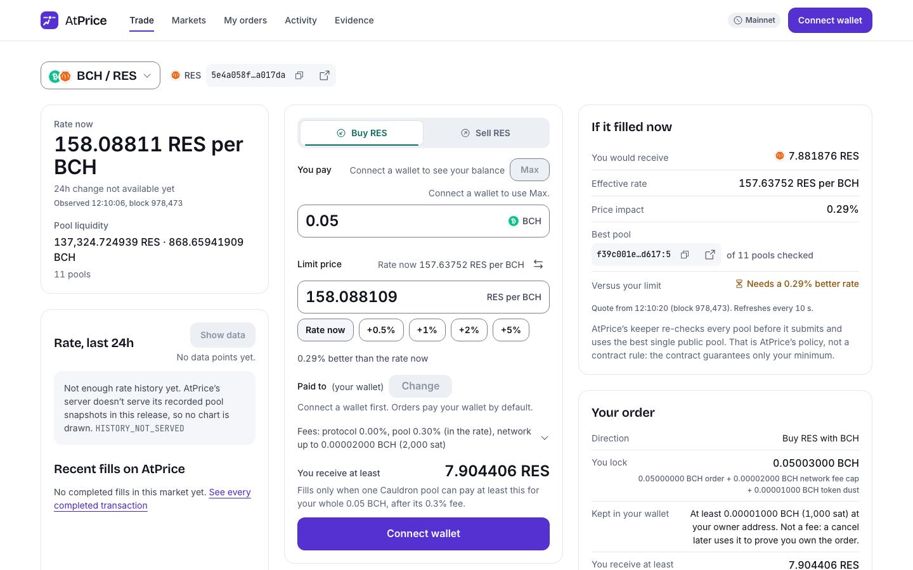
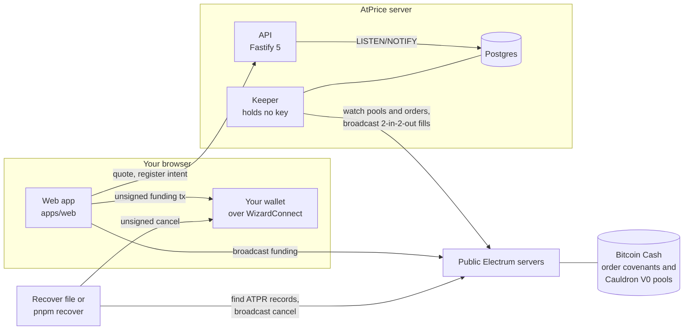
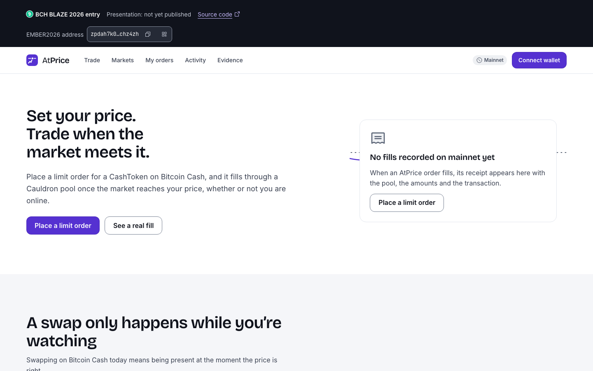
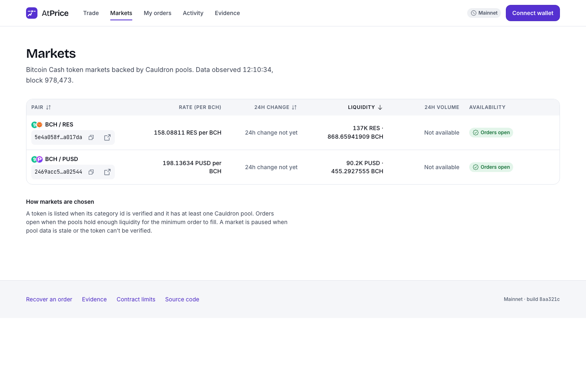
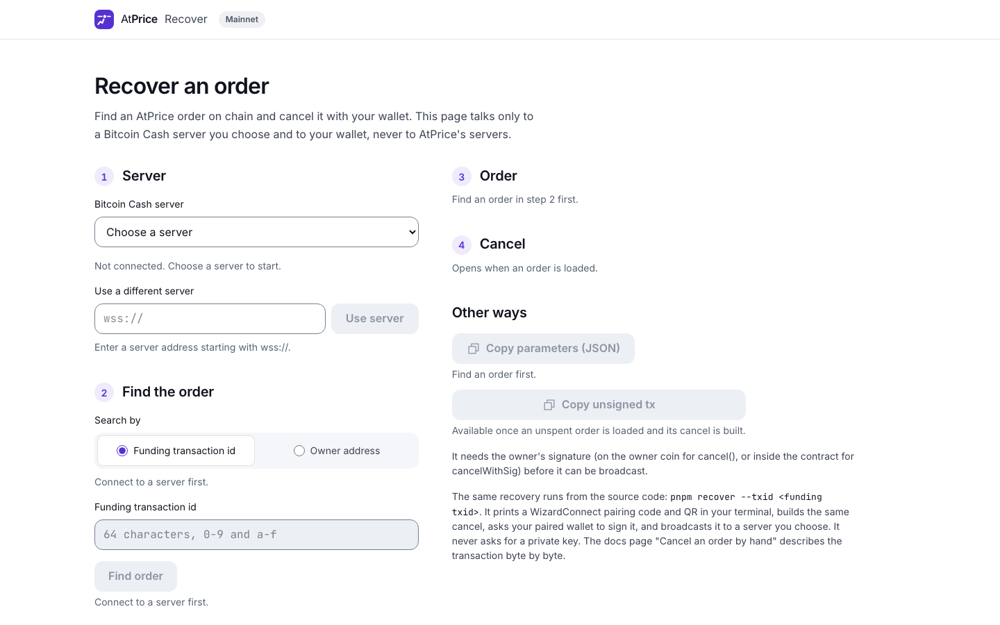
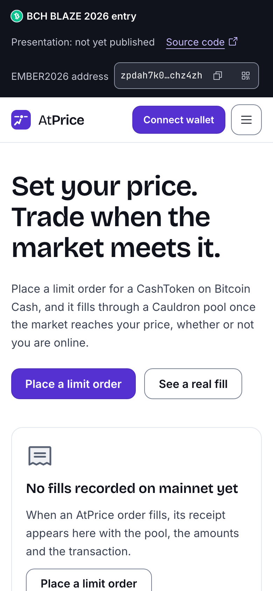
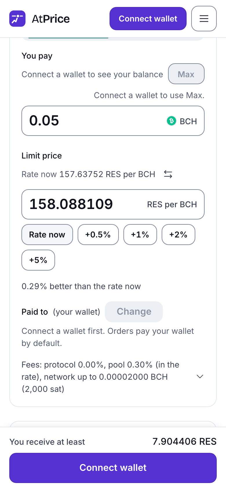

# AtPrice

[](https://github.com/winsznx/atprice/actions/workflows/ci.yml)
[](LICENSE)
[](https://atprice.cash)
[](https://atprice.cash/markets)
[](.nvmrc)

AtPrice is a non-custodial limit order service for Bitcoin Cash. You lock BCH (to buy) or a CashToken (to sell) in a small covenant that can only be spent in two ways: a fill through one genuine Cauldron V0 pool that pays you at least your limit, or a cancel that refunds you. Any party can submit the fill, and AtPrice runs a keeper that watches the pools and fills your order when the price reaches your limit. The keeper holds no key, there is no AtPrice input or output in a fill, and the protocol fee is 0%. If AtPrice disappears, you can still cancel with a single HTML file and your own wallet.



- Web app: https://atprice.cash
- Keeper health: https://api.atprice.cash/api/v1/health
- Source: https://github.com/winsznx/atprice

Mainnet markets are PUSD (ParyonUSD) and RES (Real Estate Superstable). Chipnet runs PUSDTEST. The allowlist is in [`packages/core/src/markets.ts`](packages/core/src/markets.ts).

## Contents

- [Judging quick start](#judging-quick-start)
- [Verify it yourself](#verify-it-yourself)
- [How it works](#how-it-works)
- [Architecture at a glance](#architecture-at-a-glance)
- [Screenshots](#screenshots)
- [What the contract enforces, and what it doesn't](#what-the-contract-enforces-and-what-it-doesnt)
- [Recovery without AtPrice servers](#recovery-without-atprice-servers)
- [Repository layout](#repository-layout)
- [Local setup](#local-setup)
- [Tests](#tests)
- [Deployment](#deployment)
- [BCH BLAZE 2026](#bch-blaze-2026)
- [Contributing](#contributing)
- [License](#license)

## Judging quick start

Five things to check in about two minutes, none of which need a wallet:

1. Open [atprice.cash/trade](https://atprice.cash/trade), type `0.05` in "You pay" and press "Rate now". The right column shows what the best single Cauldron pool would pay right now and the exact terms the order would lock: amount, network fee cap, the minimum you receive and how to cancel.
2. Open [atprice.cash/markets](https://atprice.cash/markets). PUSD and RES rates and liquidity are read from mainnet Cauldron pools, stamped with the block they were observed at.
3. Open [the keeper's health check](https://api.atprice.cash/api/v1/health). Each check is judged by an evaluator the keeper can't write to.
4. Open the keeper fill [`5a405b53…0d99`](https://chipnet.imaginary.cash/tx/5a405b5329d43648bfcbd80e7650b5105726e3109df4b139a95a1bc3541b0d99) on the chipnet explorer: two inputs (pool, order), two outputs (pool, payout), no AtPrice key and no AtPrice output.
5. Download the recover file from the [v1.0.0 release](https://github.com/winsznx/atprice/releases/tag/v1.0.0), compare its SHA-256 with the one in [docs/recovery.md](docs/recovery.md#1-the-recover-file), and open it from disk. It cancels an order with no AtPrice server involved.

The contract itself is short: [`AtPriceBuy.cash`](packages/contracts/src/AtPriceBuy.cash) is 80 lines, and the attacks it is tested against are in [`packages/contracts/test/adversarial`](packages/contracts/test/adversarial).

## Verify it yourself

Every claim below is a transaction on chipnet that you can open in an explorer. Mainnet orders and fills are listed on the site's [/evidence](https://atprice.cash/evidence) page, which reads them from `GET /api/v1/evidence`.

Contract behaviour, proven with real public Cauldron pools and the compiled artifacts (token PUSDTEST, category `dfe50223c8d5cba8dcef8dff6d92b61deb88a8ba44947367f2b746487b56039b`):

| What it shows                                                                                               | Transaction                                                                                                           |
| ----------------------------------------------------------------------------------------------------------- | --------------------------------------------------------------------------------------------------------------------- |
| Buy order funded, 200,000 sats, minOut 37, with the `ATPR` OP_RETURN record                                 | [`32d17d82…dce3`](https://chipnet.imaginary.cash/tx/32d17d821fb7141e854f4adf30e76466f1bc68090edda35d43af89006b4cdce3) |
| Keeper fill with no key loaded, order rebuilt from the OP_RETURN alone: 762 bytes, 39 tokens to the owner   | [`5a405b53…0d99`](https://chipnet.imaginary.cash/tx/5a405b5329d43648bfcbd80e7650b5105726e3109df4b139a95a1bc3541b0d99) |
| Fill built on the unconfirmed pool output of the previous fill, 24 tokens for minOut 22                     | [`d4df0853…3af3`](https://chipnet.imaginary.cash/tx/d4df085368b7a19b30f70eb890f42fb251912730ce0ac2fe5a2b93bdc4003af3) |
| Sell order fill: 30 tokens into the pool, 151,725 sats paid out, 723 bytes                                  | [`2b846c36…150d`](https://chipnet.imaginary.cash/tx/2b846c36a25dde1265d5e85ae5a7926694d7882fd48917270d580f2ebd50150d) |
| `cancel()` of an order the pool could not fill, authorized by an owner P2PKH input                          | [`1373677e…964b`](https://chipnet.imaginary.cash/tx/1373677ecc5b9f0cd4767ebfaca5fe2cf6ce1d9170681c41beac4df06f66964b) |
| `cancelWithSig()` of a sell order, tokens refunded                                                          | [`8bee5c8c…06c5`](https://chipnet.imaginary.cash/tx/8bee5c8c49f19d15be31719a61436a37045332727cf3455a35c41db837da06c5) |
| Fill and cancel broadcast together: the cancel confirmed, the fill was rejected with `txn-mempool-conflict` | [`dda74661…c387`](https://chipnet.imaginary.cash/tx/dda74661833fda15dd8c0b685f5f9d2c1d92edafc570a8641927d24e8192c387) |

A hand-built fill that paid the owner one token less than the pool released was rejected by the node with `mandatory-script-verify-flag-failed`, so it has no txid. The order it targeted was then filled correctly by `d4df0853…3af3` above.

The production keeper, run against public chipnet servers by `apps/server/test/live/keeper.test.ts`:

| What it shows                                                                                                      | Transaction                                                                                                                                                                                                                                                           |
| ------------------------------------------------------------------------------------------------------------------ | --------------------------------------------------------------------------------------------------------------------------------------------------------------------------------------------------------------------------------------------------------------------- |
| Two orders on one pool fill in one run, the second spending the first fill's unconfirmed pool output               | [`7fbce0f8…0e88`](https://chipnet.imaginary.cash/tx/7fbce0f859178f94932ef4228b97cf5566787259fa2db15ddde68c451a810e88), [`51a68a1a…4fe6`](https://chipnet.imaginary.cash/tx/51a68a1ac8f129af8aa77257bf8fb91643569c93793d296cff01d33165444fe6)                          |
| A third party spends the pool between build and broadcast; the keeper retries on the third party's new pool output | third party [`9e9da939…141a`](https://chipnet.imaginary.cash/tx/9e9da9395ae2533a88c170d9560da630d96959c6d76974c2d21792e04321141a), keeper retry [`5a99e989…a9bc`](https://chipnet.imaginary.cash/tx/5a99e98933b1fb44031c7610a74e80a7c908b0cda0d3d52ff9c0ed0162d7a9bc) |
| Cancel sent before the funding confirmed: `FUNDING_PENDING` to `CANCELLATION_PENDING` to `CANCELLED`               | funding [`3b933051…645c`](https://chipnet.imaginary.cash/tx/3b9330516834673e07c6b53abd0e5b384ed3f2ef467a075c114f2b20f1f0645c), cancel [`b31b5260…27d6`](https://chipnet.imaginary.cash/tx/b31b5260d5d6374036209088d53e094d1ca6e291ddf3f3e2a9db4c4ca09527d6)           |
| Cancel of an order whose funding confirmed in an earlier block                                                     | funding [`64fbe36d…901a`](https://chipnet.imaginary.cash/tx/64fbe36d30add461bc5cd2b2b30f84e2ade49decc1b3d61bdb71f9110129901a), cancel [`b5e2619c…4454`](https://chipnet.imaginary.cash/tx/b5e2619c3b1a2ef0d6cec68a8f8df1525a6489115caf2309c5a289eee1ed4454)           |

## How it works

1. In the browser, AtPrice derives the order parameters from your wallet's xpub (which never leaves the page) and the limit you type: owner key hash, recipient, token, `minOut`, a fee cap and a random nonce.
2. Your wallet signs one funding transaction over WizardConnect. It pays the order covenant (a P2SH32 address), writes an `ATPR` OP_RETURN record with every parameter, and sends change or a 1,000-sat marker back to your address.
3. The keeper watches every supported market's Cauldron pools. When one pool can release at least `minOut` for your whole order, it builds the fill, verifies it in the BCH 2026 VM and broadcasts it.

A fill is always two inputs and two outputs. Nothing else can be added:

```
inputs                                   outputs
[0] Cauldron V0 pool  (exchange branch)  [0] same pool, same script and token, new reserves
[1] your order covenant                  [1] your payout: every unit the pool released, >= minOut
```

The pool's own script enforces its constant-product rule. The order covenant checks the pool is genuine, that the whole order went in, that every unit the pool released goes to your recipient, and that the miner fee taken from the order is at most your cap. The full rules are in [docs/contract.md](docs/contract.md). The system design (keeper, indexer, health) is in [docs/architecture.md](docs/architecture.md).

## Architecture at a glance



The browser derives every order parameter itself and the wallet signs. The API and keeper work from public chain data and the intent the browser registers, and neither holds a key that can move funds. The recover path on the right never touches an AtPrice host. Details are in [docs/architecture.md](docs/architecture.md).

## Screenshots

Captured from [atprice.cash](https://atprice.cash) on mainnet.

| Landing                                          | Markets                                                     |
| ------------------------------------------------ | ----------------------------------------------------------- |
|     |  |
| Recover, served by the site and as a single file | Trade, with an order ready to fund                          |
|  |                 |

At 390 px wide:

<p>
  
  
</p>

## What the contract enforces, and what it doesn't

Enforced on chain, by [`AtPriceBuy.cash`](packages/contracts/src/AtPriceBuy.cash) and [`AtPriceSell.cash`](packages/contracts/src/AtPriceSell.cash):

- Funds leave the covenant only through a fill paying your recipient, or a cancel refunding your address with the same tokens.
- You receive at least `minOut` (tokens for a buy, satoshis for a sell).
- The pool input and output and the payout carry the token you chose.
- Only your key can cancel, and a cancel refund is at least the order value minus your fee cap.
- No AtPrice key exists that could move the funds. A protocol fee is structurally impossible under this contract version.

Stated limits:

- One pool per fill. The order is never split across pools.
- Fill or kill. The whole order fills in one transaction or not at all.
- Good till cancelled. There is no expiry, so cancel when you no longer want the order.
- Any filler may fill at exactly your limit. Filling is permissionless and the filler picks the pool, so someone can route through a pool priced at your limit and keep the improvement. The contract guarantees `minOut`, and that the pool actually used keeps nothing that belongs to you. AtPrice's keeper picks the single public pool with the best output, which is keeper policy and not a contract property.
- Fills need a Cauldron V0 pool for the token.
- Not independently audited. See [SECURITY.md](SECURITY.md).

## Recovery without AtPrice servers

`apps/recover` builds one self-contained HTML file per network. Open it from disk, point it at any public Electrum server, enter your funding txid or owner address, and it finds your `ATPR` records, rebuilds the contract and has your wallet sign a cancel over WizardConnect. It makes no request to any AtPrice host. The same file is served at https://atprice.cash/recover, and `pnpm recover` runs the same logic in a terminal. Neither ever asks for a private key.

Both files are also attached to each [GitHub release](https://github.com/winsznx/atprice/releases), and their SHA-256 hashes are listed in [docs/recovery.md](docs/recovery.md#1-the-recover-file). Step-by-step instructions, and how to build the cancel by hand, are in [docs/recovery.md](docs/recovery.md).

## Repository layout

```
apps/web            Next.js 16 web app (deployed to Vercel)
apps/server         API (Fastify 5) and keeper: one image, two processes, plus migrations
apps/recover        standalone recovery HTML file and the `pnpm recover` CLI
packages/contracts  CashScript sources, compiled artifacts, unit and adversarial tests
packages/core       order params, OP_RETURN codec, quote maths, fund/execute/cancel builders, state machine
packages/chain      Electrum, Rostrum and Cauldron indexer clients, network config, explorer links
packages/api-schema shared zod schemas for the API
e2e                 Playwright screen captures
phase0              chipnet probes and the harness behind the evidence above
deploy              Docker Compose files and Caddyfile for the server stack
docs                architecture, contract, recovery and runbook
```

## Local setup

Requirements: Node 24, pnpm 12 (`packageManager` pins 12.16.1), and PostgreSQL (CI uses 16).

```sh
pnpm install --frozen-lockfile
pnpm build                     # contracts, packages, recover file, server, web
```

Server: copy [`apps/server/.env.example`](apps/server/.env.example) to `apps/server/.env` and set:

| Variable                      | Needed by   | Notes                                                   |
| ----------------------------- | ----------- | ------------------------------------------------------- |
| `ATPRICE_NETWORK`             | api, keeper | `chipnet` or `mainnet`                                  |
| `DATABASE_URL`                | api, keeper | `postgres://` URL                                       |
| `API_PORT`, `API_HOST`        | api         | default example `4000`, `0.0.0.0`                       |
| `WEB_ORIGIN`                  | api         | origin of the web app, used for CORS                    |
| `TRUST_PROXY`                 | api         | `none`, a hop count, or the reverse proxy's addresses   |
| `HEALTH_EVAL_INTERVAL_MS`     | api         | independent health evaluator period, default 30000      |
| `KEEPER_SWEEP_INTERVAL_MS`    | api, keeper | fallback sweep period, default 30000                    |
| `ELECTRUM_SERVERS`            | optional    | replaces the built-in list; at least two distinct hosts |
| `ATPRICE_COHORT`, `LOG_LEVEL` | optional    | analytics cohort, pino level                            |

Each missing or invalid variable fails boot with a named code such as `ENV_MISSING_DATABASE_URL`.

```sh
pnpm --filter @atprice/server migrate
pnpm --filter @atprice/server dev:api
pnpm --filter @atprice/server dev:keeper
```

Web: copy [`apps/web/.env.example`](apps/web/.env.example) to `apps/web/.env.local` and set `NEXT_PUBLIC_ATPRICE_NETWORK` (must match the API) and `NEXT_PUBLIC_API_URL` (the API origin; the client appends `/api/v1`). The BLAZE banner variables are optional. The web build serves the recover file, so build `apps/recover` first (`pnpm build` does).

```sh
pnpm --filter @atprice/web dev
```

Other root scripts: `pnpm typecheck`, `pnpm lint`, `pnpm format:check`, `pnpm recover`, `pnpm audit`.

## Tests

`pnpm test` at the root, measured on 2026-11-22: 77 test files and 1,248 tests, all passing.

| Package               | Files | Tests |
| --------------------- | ----- | ----- |
| `packages/contracts`  | 15    | 420   |
| `packages/core`       | 11    | 189   |
| `packages/chain`      | 2     | 24    |
| `packages/api-schema` | 1     | 3     |
| `apps/server`         | 11    | 206   |
| `apps/recover`        | 3     | 47    |
| `apps/web`            | 34    | 359   |

Contract tests run the compiled artifacts against the real Cauldron V0 template in libauth's `BCH_2026_05` VM. The adversarial suite in [`packages/contracts/test/adversarial`](packages/contracts/test/adversarial) covers underpayment, fee over cap, value left in the pool, redirected payout, fake pools, the pool's withdraw branch, wrong token category and extra inputs or outputs.

`apps/server` integration tests need Postgres. They reset a database whose name must contain `atprice_test`, set through `TEST_DATABASE_URL`. Live chipnet suites are separate and not counted above: `pnpm --filter @atprice/server test:live` and `pnpm --filter @atprice/chain test:live`.

## Deployment

- Web: Vercel, deployed as a prebuilt output built locally (`vercel build --prod`, then `vercel deploy --prebuilt --prod`, both run from the repository root; the Vercel project's root directory is `apps/web`).
- API, keeper and Postgres: one VPS with Docker Compose, using [`deploy/docker-compose.kordaen.yml`](deploy/docker-compose.kordaen.yml) behind the host's shared Caddy. [`deploy/docker-compose.yml`](deploy/docker-compose.yml) is the self-contained variant with its own Caddy ([`deploy/Caddyfile`](deploy/Caddyfile)).

Steps, env files, health reasons, alerts and outage response are in [docs/runbook.md](docs/runbook.md).

## BCH BLAZE 2026

AtPrice was built for the BCH BLAZE 2026 hackathon and is submitted to the Mainnet Track. It runs on Bitcoin Cash mainnet with real PUSD and RES markets. The pilot runs at a 0% protocol fee.

## Contributing

Setup, the checks CI runs and the rules for contract changes are in [CONTRIBUTING.md](CONTRIBUTING.md). Changes are recorded in [CHANGELOG.md](CHANGELOG.md), and everyone taking part follows the [Code of Conduct](CODE_OF_CONDUCT.md). Security issues go through [SECURITY.md](SECURITY.md), not public issues.

## License

[MIT](LICENSE)
